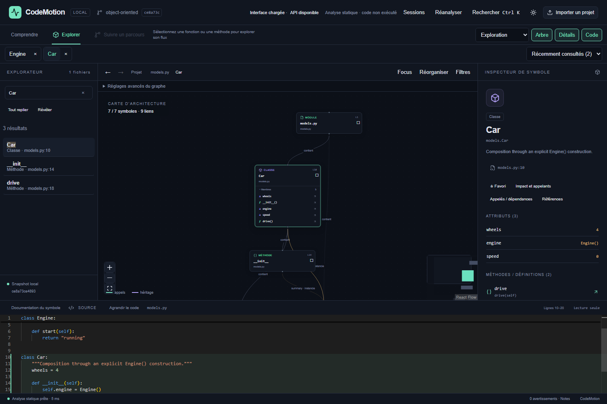
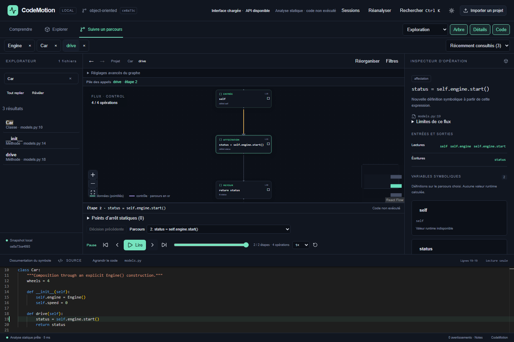

# CodeMotion

Explorez les objets et les chemins de données d’un projet Python dans une application web locale.
CodeMotion analyse l’AST : il **n’exécute jamais le code du projet importé**. Les deux vues utilisent les mêmes symboles et positions source.



## Disponible dans cette version

- Import d’un dossier depuis le navigateur, avec `.gitignore` et exclusions usuelles ; import HTTPS d’un dépôt GitHub public à une révision identifiée.
- Classes, méthodes, fonctions imbriquées, paramètres, décorateurs, annotations, attributs de classe et d’instance.
- Imports internes/externes, héritage, instanciations, appels individuels et résumé des relations. Statuts `resolved`, `candidate`, `unresolved`, `external` visibles.
- **Object Inspector** : graphe déplaçable, zoom, minimap, filtres, focus, recherche, membres et relations cliquables.
- **Data Flow Player / Static Flow** : graphe de contrôle, dépendances définition–usage, versions symboliques, lecture/pause, pas précédent/suivant, vitesse et historique.
- Choix explicite des branches et d’une itération **symbolique** de boucle. Aucun résultat d’exécution ni nombre d’itérations inventé.
- Navigation dans les fonctions appelées, bornée à huit appels imbriqués, indépendamment de l’historique ; retour au contexte précédent.
- Monaco en lecture seule, distribué localement, synchronisé avec la sélection. Thèmes sombre/clair, panneaux redimensionnables, réduction des animations selon les préférences système.
- Jobs isolés annulables, limites de ressources, diagnostics par fichier, cache mémoire par contenu, snapshots persistants et exports versionnés.

## Exploration V2

- Graphes contrôle/données/combinés, filtre par variable, masquage de `self`, orientation et positions conservées.
- Arbre repliable avec révélation du symbole, favoris, recherche globale **Ctrl+K** (symboles, fichiers via leur chemin, texte et commandes).
- Inspection libre indépendante du lecteur ; retour à l’étape active et pile des appelants.
- Références sémantiques depuis Monaco (clic ou **F12**), définitions/usages et transmission des arguments.
- Packages/dossiers agrégés, voisinage entrant/sortant à profondeur réglable et limites affichées.
- Impact et preuves source, chemins entre symboles, cycles d’imports et métriques architecturales configurables.
- **Sessions** : snapshots récents sur disque, parcours nommés, restauration, renommage, suppression et comparaison.
- **Exporter** : PNG, SVG, JSON, Mermaid, Markdown du parcours et lien direct local.
- Panneaux repliables, redimensionnables et maximisables ; thèmes clair/sombre et tiroirs sur petit écran.
- Import GitHub public avec branche, tag ou SHA ; réanalyse du contenu du snapshot.

Guide des parcours, API et formats : [Exploration V2](docs/exploration-v2.md). Résultats et captures : [Validation V2](docs/validation-v2.md). Les limites restantes sont détaillées dans [limitations](docs/limitations.md).

## Parcours avancés

Le lecteur affiche désormais une pile d’appels, une vue **Autour de l’étape active**, le suivi des variables sur le parcours et la **comparaison de deux parcours nommés**. L’inspection met la lecture en pause. Les déclarations et paramètres sont navigables avec F12. L’export accepte plusieurs nœuds cochés. Commandes et infobulles sont en français.

Voir le [guide d’utilisation](docs/exploration-v2.md) et le [rapport de validation du 17 octobre](docs/validation-workflow.md).

## Installation

Prérequis : **Python 3.11+**, **Node.js 24**, npm. Internet est nécessaire pour installer les dépendances ; après installation, les dossiers locaux et les exemples fonctionnent hors ligne. Aucun compte, LLM, abonnement, Docker ou clé API.

### Windows / PowerShell

Depuis le dossier du projet :

```powershell
python -m venv .venv
.\.venv\Scripts\python.exe -m pip install -r requirements.lock
.\.venv\Scripts\python.exe -m pip install -e . --no-deps
npm.cmd ci --prefix frontend
node frontend/scripts/copy-monaco.mjs
.\.venv\Scripts\python.exe scripts/run.py
```

Si `python` ouvre le Microsoft Store, utilisez un Python installé (`py -3.12`, par exemple) pour la première commande. L’environnement `.venv` créé dans le dossier de travail est déjà utilisable sur la machine de développement.

### Linux / macOS

```bash
python3 -m venv .venv
.venv/bin/python -m pip install -r requirements.lock
.venv/bin/python -m pip install -e . --no-deps
npm ci --prefix frontend
node frontend/scripts/copy-monaco.mjs
.venv/bin/python scripts/run.py
```

Ouvrir **http://127.0.0.1:3000**. Documentation API : **http://127.0.0.1:8000/docs**.
`Ctrl+C` dans le lanceur arrête les deux processus. Ils écoutent sur `127.0.0.1`.

Pour lancer séparément :

```powershell
.\.venv\Scripts\python.exe -m uvicorn app.main:app --host 127.0.0.1 --port 8000
npm.cmd --prefix frontend run dev
```

Pour le build de production : `npm run build --prefix frontend`, puis `python scripts/run.py --production` avec le Python de `.venv`.

## Démonstration

1. Cliquer **Explore the example**, ou importer `examples/object-oriented`.
2. Sélectionner `Car` : voir `wheels`, `engine`, `speed` et l’instanciation de `Engine` observée dans `__init__`.
3. Sélectionner `drive`, puis **Explore Data Flow**.
4. Avancer vers `status = self.engine.start()`. L’appel vers `start` reste candidat : l’attribut est mutable.
5. Utiliser **Inspect Object / Function** pour revenir. L’onglet Data Flow conserve le parcours.
6. Importer `branching` et choisir `True` ou `False`. Dans `loops`, choisir **Body (symbolic)** puis **Exit**.



Les exemples sont de vrais fichiers Python analysés par le même moteur que vos projets. Aucun graphe JSON factice n’alimente l’application.

## Architecture

```text
backend/app/
  analysis/    chargement, AST, symboles/imports, classes, contrôle/données, graphe
  models/      schéma Pydantic versionné
  services/    processus d’analyse, annulation et cache borné
  main.py      API FastAPI et contrôle des requêtes
frontend/src/
  components/  explorateur, canvas React Flow, inspecteurs, Monaco, lecteur
  lib/         types, client API, navigation déterministe du lecteur
examples/      cinq projets Python reproductibles
tests/e2e/     parcours Playwright utilisant le backend réel
scripts/       lancement, vérifications, benchmark
docs/          architecture, limites, mesures, schéma et captures réelles
```

Stack : Python AST, FastAPI, Pydantic, pathspec, httpx ; Next.js, React, TypeScript strict, React Flow, Dagre, Monaco, Lucide. État React et transitions CSS : pas de gestionnaire global ou bibliothèque d’animation supplémentaire nécessaire à cette version.

Le moteur est indépendant de React et ne dépend d’aucune IA. La lecture d’un flux déjà chargé et de sa source fonctionne sans API ; entrer dans une fonction non mise en cache nécessite le backend.

## Vérification

```powershell
.\.venv\Scripts\python.exe scripts/check.py
cd frontend
npx playwright install chromium
cd ..
.\.venv\Scripts\python.exe scripts/check.py --e2e
```

Sous Linux/macOS, remplacer le chemin Python par `.venv/bin/python`.
Les commandes individuelles figurent dans [le rapport de validation](docs/validation.md).
La CI fournie lance Ruff, mypy, Pytest, TypeScript, ESLint, Vitest, le build Next et Playwright sans secret. Le workflow est écrit localement ; aucun push ni aucune PR n’a été effectué.

Les versions npm sont verrouillées dans `frontend/package-lock.json` ; les dépendances Python, y compris celles de développement, dans `requirements.lock`. Le script `postinstall` copie Monaco localement ; la commande explicite est fournie si les scripts npm sont désactivés.

## Exactitude et limites

Il s’agit d’une **analyse statique partielle**, pas d’un débogueur ni d’une trace d’exécution.
Les valeurs concrètes sont généralement inconnues. Un littéral affiché est le littéral à sa définition, pas une garantie de valeur ultérieure.
Les types annotés et les récepteurs inférés ne sont pas des preuves d’exécution. Les imports dynamiques, la réflexion, le monkey patching, les mutations via alias et les extensions natives restent partiellement ou totalement indéterminés.

`try/except/else/finally`, `with` et `match` disposent de chemins structurés conservateurs avec diagnostics précis. Les exceptions implicites sont représentées à l’entrée du `try`, les protocoles de contexte et de motifs ne sont pas exécutés. `except*` reste opaque. Le moteur ne calcule pas un MRO C3 complet, n’implémente pas une SSA complète et ne propage pas de valeurs entre fonctions. La navigation interprocédurale ouvre leurs graphes statiques séparés.

Voir [les limites détaillées](docs/limitations.md), [le moteur](docs/analysis-engine.md), [la sécurité et l’API](docs/architecture.md), [l’inspecteur](docs/object-inspector.md) et [le lecteur](docs/data-flow-player.md).

## Performances et évolution

Les mesures réellement exécutées sur 10, 100, 500 fichiers synthétiques et un projet RL de 123 fichiers sont conservées dans [docs/benchmarks.json](docs/benchmarks.json). Elles dépendent du matériel et de la complexité du code ; ce ne sont pas des garanties.

Priorités suivantes : exceptions implicites par opération, protocoles des context managers, MRO C3, inférence sensible aux chemins, exploration incrémentale et tests multi-navigateurs.

Licence MIT. Aucun dépôt utilisateur analysé n’est modifié.

## Usage quotidien et moteur 2.1

Sous Windows, double-cliquer sur **Lancer CodeMotion.cmd** à la racine du dépôt. Il utilise les dépendances déjà installées, lance les deux services en mode développement et ouvre le navigateur lorsqu’ils répondent. Garder sa console ouverte ; **Ctrl+C** arrête les processus de ce lancement. Les ports déjà occupés sont signalés sans arrêter un autre programme. Pour le mode compilé : `"Lancer CodeMotion.cmd" --production` depuis cmd, après le build frontend. Le statut en haut de l’interface vérifie l’API toutes les 15 secondes.

Dans le lecteur, ouvrir **Points d’arrêt statiques** pour s’arrêter avant les appels, les écritures d’une variable ou une opération choisie. Lire reprend au-delà de l’arrêt une fois ; Étape suivante le franchit volontairement. L’opération en attente n’entre pas encore dans le parcours. La configuration est conservée par snapshot et fonction.

Dans **Sessions**, enregistrer le travail courant puis **Exporter la sauvegarde**. Le JSON contient les sessions, les parcours nommés, les points d’arrêt et les snapshots associés, code source inclus. **Importer une sauvegarde** restaure ces données localement : noms de sessions en conflit suffixés, parcours et points d’arrêt existants conservés. Aucun code importé n’est exécuté. Limites : 30 sessions/snapshots, 120 Mo par sauvegarde, 40 Mo par snapshot restauré, 4 Mo de métadonnées et quota du navigateur. Un snapshot source supprimé doit être réimporté avant l’export. Une erreur d’import peut laisser les snapshots déjà restaurés ; les sessions ne sont écrites qu’après leur restauration. Le budget disque de 256 Mo continue de s’appliquer.

**Comparer au snapshot actif** prend le snapshot actif comme base et le snapshot choisi comme cible. Le résultat montre les fonctions modifiées, les appelants impactés (avec preuves dans la base), les suppressions et les sessions/parcours à reconstruire. La compatibilité vérifie le flux complet et la pile d’appels ; elle ne migre aucun parcours. Réanalyser les deux versions si leurs moteurs diffèrent. Les archives 2.0 restent lisibles ; Réanalyser les fait passer au moteur 2.1, ce qui peut invalider d’anciens parcours.

## Navigation interactive depuis le README

Importer à nouveau un dossier ou un dépôt inclut désormais ses fichiers `.md` et `.markdown`, en respectant les mêmes exclusions et budgets que Python. Les anciens snapshots ne contiennent pas ces documents : **Réanalyser** ne peut pas récupérer des fichiers qui n’avaient pas été importés.

1. Ouvrir **Comprendre le projet**. Choisir un document, une section dans le sommaire ou rechercher dans la documentation.
2. Cliquer sur un lien local, une mention de symbole entre backticks ou une commande Python documentée pour ouvrir sa cible. Une commande n’est jamais exécutée. Les liens `#L12` ouvrent la ligne correspondante et les ancres Markdown ouvrent leur section.
3. Si plusieurs définitions correspondent, choisir explicitement une cible avant d’ouvrir sa définition ou son flux. Les liens absents ou interdits sont signalés ; une recherche manuelle permet de sélectionner un symbole.
4. Depuis le code, **Documentation du symbole** retrouve les sections qui citent la sélection. Le document et la section consultés sont conservés lors d’un aller-retour. Précédent/Suivant conservent sélection, source, étape, filtres et cadrage du graphe.
5. Utiliser **Générer un guide depuis cette section**, ou ajouter individuellement des cibles. Nommer le guide, réordonner ou retirer les étapes, puis enregistrer. **Reprendre le guide** ouvre l’étape mémorisée ; le bandeau permet de passer à la suivante et de retourner au README.

Les guides suivent l’ordre des mentions documentées : ce ne sont pas des traces d’exécution. Ils sont conservés par snapshot, avec 20 guides de 30 étapes maximum, et inclus dans les sauvegardes de Sessions. Un nom existant n’est pas écrasé ; dupliquer permet de modifier un parcours.

L’exemple local `examples/readme-navigation` illustre les liens, les noms ambigus, les ancres et les guides. Le rendu Markdown est volontairement limité (titres ATX, paragraphes, gras, code et liens inline). HTML, scripts et images distantes ne sont pas exécutés/chargés. L’index documentaire est borné à 40 documents, 50 000 caractères par document, 200 000 au total, 200 sections par document et 500 références au total ; les troncatures sont signalées. Le sélecteur liste tous les Markdown archivés ; choisir un document le place en tête de l’index pour le charger à la demande. Les tableaux, liens de référence et ancres HTML ne bénéficient pas d’une interprétation complète. Les liens vers des fichiers non importés peuvent être signalés absents même si ces fichiers existent dans le dépôt.


### Accueil, onglets et guides entre versions

À l’import d’un projet avec Markdown, l’accueil « Comprendre » propose À propos,
Commencer ici, Architecture et Reprendre mon parcours. Les titres du README servent
à orienter ces raccourcis ; sans section Architecture, la carte ouvre l’arborescence.
Les listes simples, tableaux, citations et blocs de code sont rendus sans exécuter le HTML.

Les modes sont **Comprendre**, **Explorer** et **Suivre un parcours**. Les réglages
avancés du graphe sont repliés. Jusqu’à 12 définitions restent ouvertes dans des onglets ;
le survol ou le focus clavier donne un aperçu (Échap pour fermer). Le sélecteur des
30 éléments récents et les onglets sont propres à la session du navigateur et au snapshot.
Les onglets retrouvent la sélection, le parcours, la pile et le cadrage mémorisés.

Un guide peut rassembler plusieurs sections, avec une note de 2 000 caractères par étape
et une case « Étape terminée ». Les notes et la progression sont sauvegardées localement
et incluses dans les sauvegardes. Les relations directes identifiées entre étapes portent
leur niveau de résolution ; elles ne garantissent pas un ordre d’exécution.

Dans « Documentation et guides entre versions », choisissez un ancien snapshot local.
La comparaison signale les mentions disparues, les liens devenus invalides et les cibles
modifiées dans le périmètre indexé. Pour récupérer un ancien guide, choisissez et validez
chaque nouvelle cible, puis enregistrez une copie nommée. Aucune cible n’est validée
par simple similarité de nom ; les anciens guides sont conservés. La progression est
remise à zéro pour la version migrée, tandis que les notes et la position de reprise sont conservées.
Les références au document d’origine restent des indications de provenance : une section
supprimée sera signalée à l’ouverture. Un snapshot évincé ne permet plus la comparaison,
mais ses guides locaux peuvent encore être récupérés.
