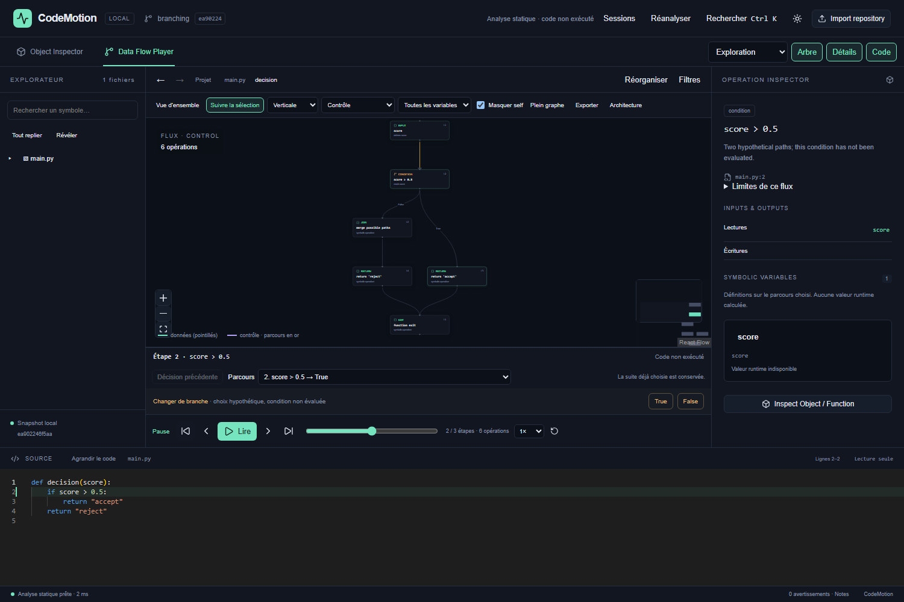
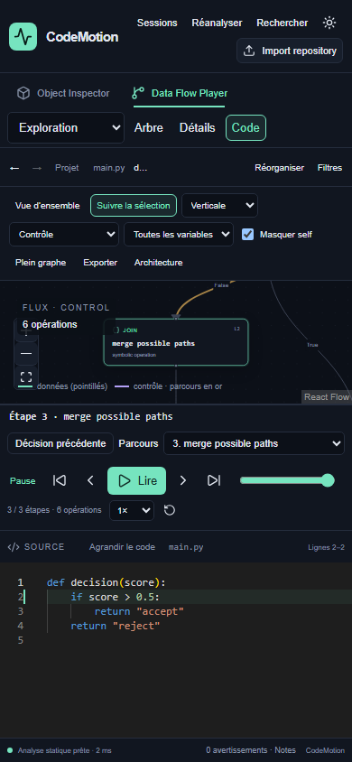

# Exploration V2 : utilisation, API et formats

## Parcours

Importer un dossier Python ou une URL GitHub publique. Pour GitHub, renseigner éventuellement une branche, un tag ou un SHA. Le SHA analysé est conservé dans le snapshot. Aucun code importé n’est exécuté.

Déplier les dossiers puis les classes ; utiliser Révéler pour retrouver la sélection. Ctrl+K ouvre la recherche de symboles/texte et les commandes. Sélectionner une fonction ou méthode active Data Flow Player. Le lecteur attend un choix aux branches et boucles ; cliquer une opération inspecte sa source sans changer le parcours. Revenir à l’étape active rétablit l’inspection courante. Entrer dans un appel empile son contexte ; Retour à l’appelant restaure l’étape précédente.

Les menus Contrôle/Données/Les deux, variable et Masquer self règlent les arêtes. Réorganiser recalcule la disposition ; Vue d’ensemble revient aux groupes du projet ; le bouton de cadrage du canvas ajuste le zoom. Le suivi de sélection peut être désactivé pour garder une zone visible. L’inspecteur propose références, impact, chemins et favoris. Cliquer une variable ouvre définitions, usages et transmissions vers les paramètres. Architecture expose cycles et seuils configurables.

Sessions enregistre explicitement le parcours courant, ses choix, favoris, filtres, dimensions et positions. Restaurer exige un snapshot compatible. Les snapshots récents sont indépendants des sessions du navigateur : supprimer un snapshot peut rendre un parcours indisponible. Comparer choisit un autre snapshot présent localement.

Exporter génère localement les cinq formats et le lien direct. Le Markdown en mode flux décrit le parcours effectivement choisi ; il ne prétend pas être une trace d’exécution. Les preuves d’analyse renvoient à des positions source.

## API

Base `http://127.0.0.1:8000/api`. Schémas exacts interactifs dans `/docs`, OpenAPI dans `/openapi.json`. Les routes existantes d’import, jobs, symboles, source, flux et export complet restent disponibles.

| Route | Paramètres / résultat |
| --- | --- |
| GET `/snapshots` | Métadonnées récentes, versions, taille |
| DELETE `/snapshots/{id}` | Supprime l’archive locale identifiée |
| POST `/repositories/{id}/reanalyze` | Job de réanalyse des sources du snapshot |
| GET `/repositories/{id}/neighborhood` | focus, pin, direction in/out/both, depth 0–8, relations, offset, limit 1–1000, edge_limit 1–5000 ; totaux et troncature |
| GET `/repositories/{id}/hierarchy` | prefix, offset, limit ; groupes dossiers/fichiers et liens agrégés |
| GET `/repositories/{id}/group-relations` | source, target, limit ; preuves des relations du groupe |
| GET `/repositories/{id}/search` | q, mode symbols/text, offset, limit 1–200 |
| GET `/repositories/{id}/variables/{function}` | name ; définitions, usages, arêtes et bindings |
| GET `/repositories/{id}/semantic` | file, line (base 1), column UTF-16 (base 0) ; cibles et références |
| GET `/repositories/{id}/references/{symbol}` | offset, limit 1–500 ; usages, total, troncature |
| GET `/repositories/{id}/impact/{symbol}` | depth 1–8, limit 1–1000 ; chemins/preuves et candidats tests |
| GET `/repositories/{id}/paths` | start, target, depth 1–12, limit 1–100, relations |
| GET `/repositories/{id}/architecture` | long_lines, members, connections ; métriques et cycles |
| GET `/repositories/{id}/compare/{other}` | ajouts, suppressions, changements et impact borné |

Erreurs : 400 pour une requête métier invalide, 404 pour un snapshot absent/incompatible, 422 pour les paramètres hors bornes. Les statuts resolved/candidate/unresolved/external sont conservés ; resolved signifie liaison statique, pas certitude runtime.

## Persistance

Archive : `.codemotion/snapshots/{id}.json` (Analysis Pydantic, schema_version 1.0, engine_version 2.0), `{id}.meta` (format 1, repository, engine_version, bytes). Identifiant hexadécimal de 24 caractères. Écriture via fichier temporaire puis remplacement ; budget 256 000 000 octets des JSON. Le moteur vérifie version, identifiant et structure à la restauration ; les fichiers invalides ne sont pas exécutés.

Sessions : clé localStorage `codemotion.sessions.v1`, tableau de 30 éléments maximum, chacun `{format:1, repository, snapshot, title, savedAt, state}`. `state` contient vue, parcours, pile, filtres, panneaux, favoris et canvas (positions/viewport). La restauration valide types, bornes et continuité des arêtes du parcours. Le lien `#codemotion=...` transporte un état JSON encodé, pas les fichiers du projet.

Export de vue JSON : `metadata.schema_version: 2.0`, repository, engine, scope, filters, truncated, nodes/edges, uncertainty, created ; tableaux nodes et edges. À distinguer du schéma d’analyse complet 1.0. SVG et Mermaid embarquent ces métadonnées ; Markdown porte snapshot, moteur, provenance et limites.

## Lecteur : navigation du parcours (16 octobre 2026)

Le bandeau du lecteur rappelle l’expression de l’étape active, même lorsque l’inspecteur est fermé. Le menu **Parcours** permet de rejoindre une étape déjà visitée et affiche la branche enregistrée. **Décision précédente** revient à la dernière bifurcation ; choisir une autre branche remplace uniquement la suite du parcours.

Le bouton de retour au début conserve les étapes et les choix. Le bouton de réinitialisation efface le parcours. **Lire/Pause**, les flèches et la timeline restent disponibles ; les flèches clavier interrompent la lecture automatique. Les raccourcis ne s’appliquent pas aux champs, à Monaco ni aux dialogues ouverts. Un dialogue interrompt également l’avancement automatique à son prochain tick.

La limite de 2 000 étapes interdit d’allonger davantage le parcours mais permet de revenir en arrière et de choisir une autre branche. Aucun code Python n’est exécuté.

Validation de cette évolution : 19 tests frontend, lint, TypeScript/build production et quatre parcours navigateur ciblés réussis (import/lecture hors ligne, branches/boucles, inspection/session/export, rembobinage et décisions sur desktop/mobile).

